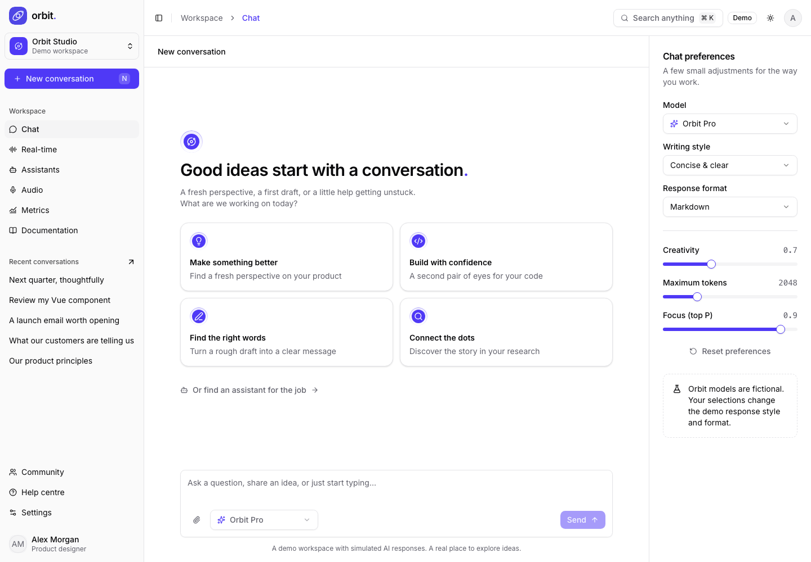
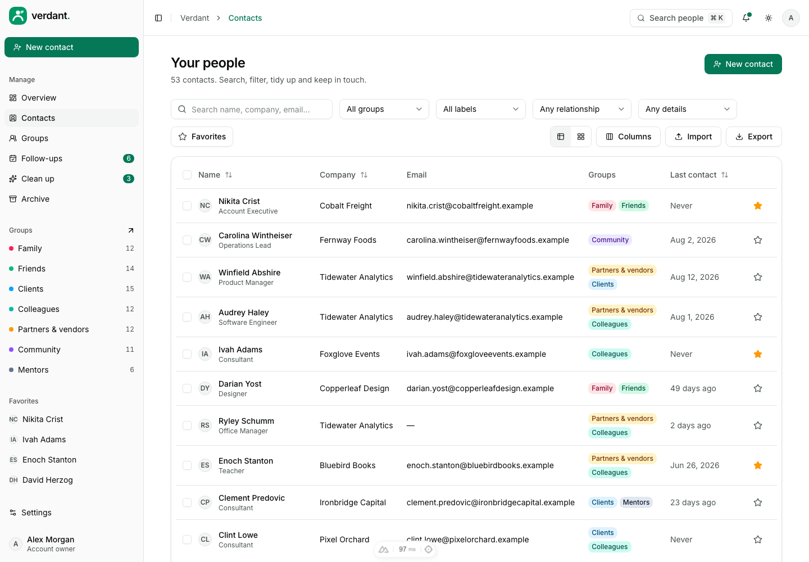
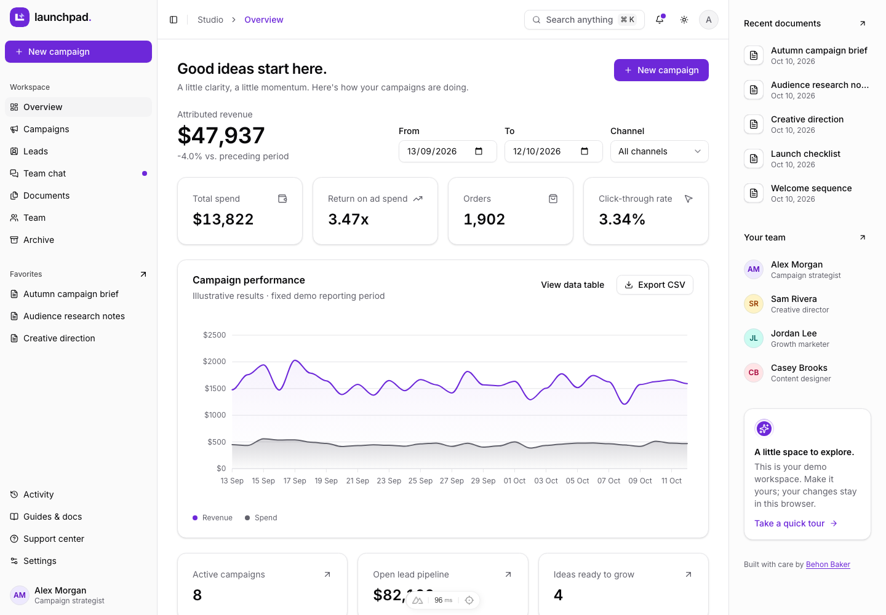
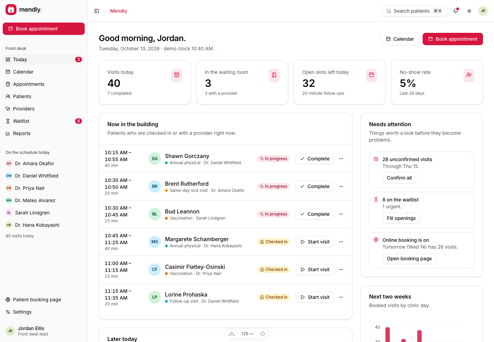
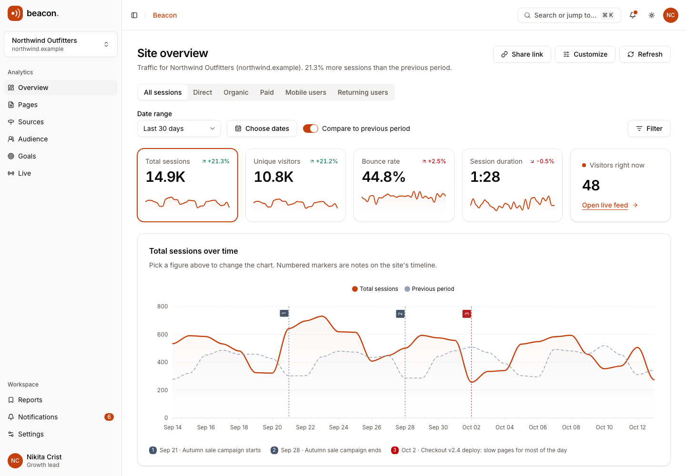

# UI Thing Layouts & Examples

A collection of layouts created with the [UI Thing](https://uithing.com/getting-started/introduction) library.

## Layouts

- [Orbit — AI Chat](ai-chat/) - An interactive Nuxt AI workspace with chat, assistants, local audio, analytics, and optional demo auth. [Live site](https://ai-chat-ui.behonbaker.com) (deployment managed separately).
   

---

- [Verdant — Contact manager](contacts-ui/) - An interactive Nuxt contact manager with searchable contacts, groups, follow-ups, duplicate merging, CSV/vCard import and export, and local demo APIs. [Live site](https://verdant.behonbaker.com) (deployment managed separately).
   

---

- [Launchpad — Campaign workspace](campaign-ui/) - An interactive Nuxt marketing workspace with campaigns, leads, team chat, editable briefs, analytics, and local demo APIs. [Live site](https://campaigns-ui.behonbaker.com) (deployment managed separately).

---

- [Mendly — Appointment workspace](dr-appointment-ui/) - An interactive Nuxt clinic scheduling app with a double-booking-proof calendar, a front-desk workflow, patients, providers, a waitlist, reports, a public booking page, and local demo APIs. [Live site](https://mendly.behonbaker.com) (deployment managed separately).

---

- [Beacon — Site analytics workspace](site-overview-ui/) - An interactive Nuxt web analytics app with a cross-filtering overview, a pages table, sources and audience breakdowns, goals and funnels, a live feed, saved reports, and local demo APIs. [Live site](https://beacon.behonbaker.com) (deployment managed separately).

---

- [Onboarding Steps UI](https://onboarding-steps-ui.behonbaker.com) - A responsive onboarding steps ui.
