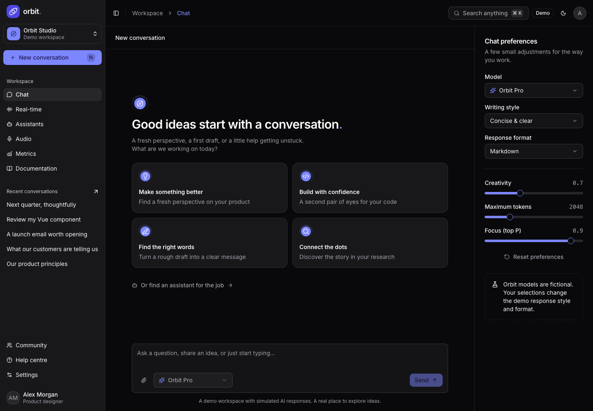
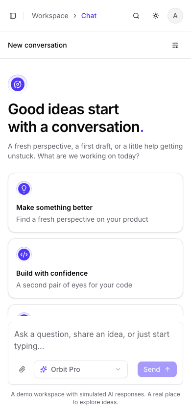

# Orbit · AI workspace

[](https://app.netlify.com/projects/ai-chat-ui-thing/deploys)
[](https://github.com/BayBreezy/ui-thing-layouts/actions/workflows/ai-chat.yml)
[](https://github.com/BayBreezy/ui-thing-layouts/blob/main/LICENSE.md)
[](https://ai-chat-ui.behonbaker.com)

[](https://nuxt.com)
[](https://vuejs.org)
[](https://tailwindcss.com)
[](https://www.typescriptlang.org)
[](https://uithing.com)
[](https://bun.sh)
[](https://nodejs.org)

[](https://playwright.dev)
[](https://vitest.dev)
[](https://github.com/dequelabs/axe-core)

A static AI Chat layout, built as an interactive application by [**Behon Baker**](https://behonbaker.com). Orbit demonstrates product design, accessible interactions, Nuxt architecture, validated APIs, and local-first state. The other folders in this repository remain independent applications.

[](https://ai-chat-ui.behonbaker.com)

## Try it locally

Use **Bun 1.4.2** and **Node 22.12+** (CI and Netlify pin Node 22.23.3; see `.nvmrc`). Bun manages dependencies and scripts; Node runs Nuxt and Nitro. No external accounts, API keys, or database are required.

```bash
cd ai-chat
bun install --frozen-lockfile
bun run dev
```

Open `http://localhost:3000`. Optionally copy `.env.example` to `.env` and set the public canonical URL. Add current UI Thing components with `bun run ui:add <component>`; review copied component changes together with their utilities.

```bash
bun run format
bun run format:check
bun run lint
bun run typecheck
bun run test
bunx playwright install chromium
bun run test:e2e
bun run build
bun run preview
# With the dev server running:
node scripts/screenshots.mjs
NITRO_PRESET=netlify bun run build
```

Oxfmt handles Vue/TypeScript formatting, import sorting, and Tailwind sorting. Oxlint checks Vue scripts; it does not lint templates. `nuxt typecheck` remains a separate required check. TypeScript is pinned to 5.9.3 because the installed Vue checker requires the classic TypeScript compiler entry point. Nuxt uses its four generated TypeScript project references.

## Styling and fonts

`app/assets/css/tailwind.css` starts with the output of `bunx ui-thing@latest theme violet` (CLI 0.3.2): theme tokens, forms plugin, animations, scrollbars, and utilities. Orbit’s indigo brand colour replaces the generated violet `--primary`, `--ring`, and sidebar accents directly in that file (the generated violet fails WCAG AA contrast for text on primary), so every design token lives in one place. `app/assets/css/orbit.css` only holds the page container, markdown prose, and reduced-motion support. Nuxt loads it after the foundation.

All corner sizes derive from the CLI’s `--radius: 0.65rem`: small subtracts 4px, medium subtracts 2px, large uses the base, and extra large adds 4px. Orbit extends this scale by 8/12/16px for larger surfaces. Buttons, inputs, and the composer keep UI Thing’s medium radius; cards use extra large. Circular avatars and indicators retain `rounded-full`. The foundation also adds the `sidebar` color alias used by the current component registry alongside the CLI’s `sidebar-background` alias, and uses a system monospace stack for code.

Typography uses UI Thing’s `@nuxt/fonts` module with a local Inter variable font in `public/fonts`, weights 100–900. No Fontsource package or remote font provider is needed during builds or page loads. The bundled font retains its SIL Open Font License.

Regenerating a theme overwrites the foundation. Re-apply the indigo `--primary`, `--ring`, and sidebar values, the documented sidebar alias, and the larger radius extensions afterwards.

## A five-minute walkthrough

1. **Chat:** choose a prompt, change the fictional model and writing style, watch the reply appear, stop/retry, copy a reply, and attach a local file. Code responses have Markdown highlighting.
2. **History:** rename and favorite the conversation, export Markdown/JSON, then refresh. Your edits remain local. Switch to Personal space to see independently scoped records.
3. **Assistants:** create a specialist with instructions and specialties, duplicate it, and launch a conversation. Edit and delete flows use validation and confirmations.
4. **Audio / Real-time:** record and play actual browser audio or choose the bundled sample. Run the scripted transcription, explore timestamped segments, or type into a live-style session. Ending a session saves a summary.
5. **Metrics / Settings:** filter sample usage plus new activity, export CSV, change appearance/profile/preferences, and export or reset local demo data. Optional account pages demonstrate validated login, signup, and recovery without a real account.

Try the command palette with **Command/Ctrl + K**, mobile navigation, dark mode, and keyboard focus. Documentation explains the APIs and architecture inside the product.

## Architecture and boundaries

| Layer                                                  | Responsibility                                                                              |
| ------------------------------------------------------ | ------------------------------------------------------------------------------------------- |
| `app/pages`, `app/layouts`, `app/components/Orbit`     | Workspace and auth layouts, feature pages, product components                               |
| `app/components/Ui`                                    | Current copied UI Thing components using Reka UI and Tailwind 4                             |
| `shared/types.ts`, `shared/schemas.ts`                 | Typed records and Yup validation shared across client/server                                |
| `server/api/demo`                                      | Stateless Nitro generators and validators with explicit error responses                     |
| `server/utils/fixtures.ts`                             | Server-only Faker factories, seed 42, fixed reference date, handwritten replies/transcripts |
| `app/composables/useDemo.ts`                           | Reactive, workspace-scoped visitor state                                                    |
| `app/plugins/persistence.client.ts`                    | Versioned localStorage restoration after hydration, validated snapshots, save feedback      |
| `app/utils/files.ts`, `app/composables/useRecorder.ts` | IndexedDB media with an in-memory fallback; permission, format detection, and cleanup       |

The first SSR render uses `useAsyncData` to fetch a populated seed. After hydration, the client restores its saved snapshot; direct links to browser-only records show a loading state. API-backed actions use pending/error/retry states. Abort signals prevent cancelled chat/media requests from updating another conversation. Charts are client-only and loaded on demand, with an accessible data-table alternative.

**This is a simulation:** fictional Orbit models return scripted variants. Chat streaming is a progressive client reveal. Transcription sends only metadata and never recognizes recorded speech. Real-time microphone input triggers a scripted prompt; typed input chooses reply variants. Browser speech playback is optional. Usage and cost are illustrative.

Accounts are presentation-only identities. Passwords are sent to the local demo validator, never stored or returned, and no email is sent. Recovery displays a labeled demo reset link. Signing out retains local content. Use fictional credentials.

Files and recordings remain on the visitor’s device. Text/metadata exports do not include media blobs. Clearing browser storage removes the local demo. Storage failure keeps the current session usable with visible save feedback. The APIs never own visitor edits or use function memory as a database.

## Verification

Vitest covers reproducible fixtures, snapshot restoration, validation, reactive workspace operations, and actual Nitro API responses through Nuxt test utilities. Playwright covers chat/history, editors, auth/recovery, direct routes, failure recovery, responsive themes, keyboard search, sample mode, microphone permission failure, unsupported recording, playback, and microphone cleanup. Axe checks accessibility automatically; manual visual inspection supplements these checks.

The scoped workflow in `../.github/workflows/ai-chat.yml` runs formatting, lint, type checking, unit/API tests, Chromium flows, a normal production build, a Faker client-bundle check, and the Netlify build. Run browser tests sequentially with production builds because both generate Nuxt artifacts.

## Netlify preparation

`netlify.toml` belongs in this application directory. On the **existing Netlify site**, configure:

- **Base directory:** `ai-chat`
- **Package directory:** `ai-chat` (relative to the repository root)
- **Configuration file:** let Netlify discover `ai-chat/netlify.toml`
- **Build command:** supplied by TOML; frozen Bun install followed by `bun run build`
- **Publish directory:** `dist`, relative to the base directory
- **Environment:** Bun 1.4.2, Node 22.23.3, `NITRO_PRESET=netlify`; optional `NUXT_PUBLIC_SITE_URL`

Commit `bun.lock`. Nitro generates server functions and routing so `/api/demo/*` works alongside SSR and static assets. Use the regular Netlify functions preset rather than static generation. The local Netlify build verifies the output; publishing and modifying the live site are separate actions.

References: [Netlify monorepos](https://docs.netlify.com/build/configure-builds/monorepos/), [Nitro on Netlify](https://nitro.build/deploy/providers/netlify), [UI Thing](https://uithing.com/getting-started/introduction), [Nuxt](https://nuxt.com/docs/4.x), [Oxc compatibility](https://oxc.rs/compatibility.html).

## Attribution

Designed and built by [Behon Baker](https://behonbaker.com). Components from [UI Thing](https://uithing.com) and [Reka UI](https://reka-ui.com), icons from [Lucide](https://lucide.dev), typography from Inter, and metadata from [Faker](https://fakerjs.dev). The bundled discovery sample is locally synthesized speech matching the handwritten demo scenario.

[](https://ai-chat-ui.behonbaker.com)

[](https://ai-chat-ui.behonbaker.com)
