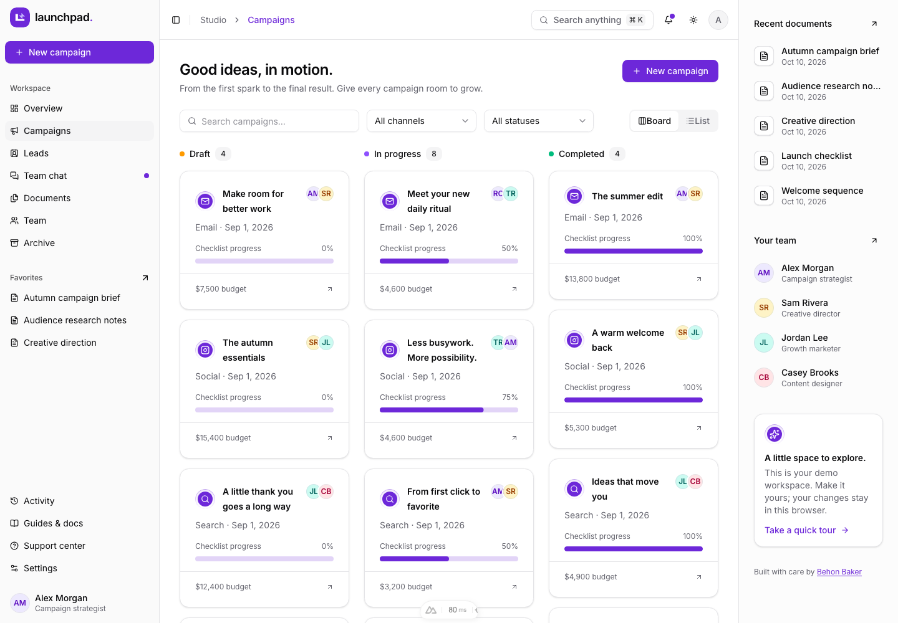
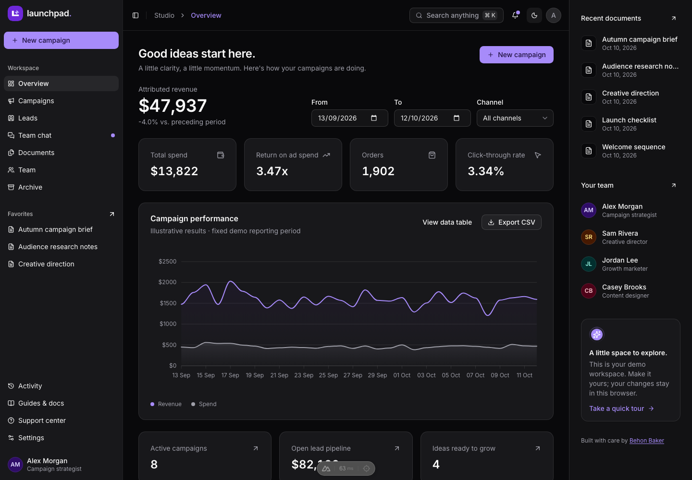
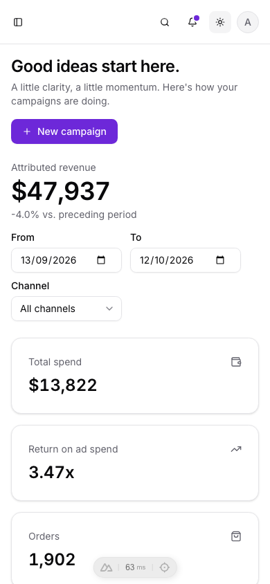

# Launchpad · Campaign workspace

[](https://github.com/BayBreezy/ui-thing-layouts/actions/workflows/campaign-ui.yml)
[](../LICENSE.md)
[](https://campaigns-ui.behonbaker.com)
[](https://nuxt.com)
[](https://tailwindcss.com)
[](https://uithing.com)
[](https://bun.sh)
[](https://www.typescriptlang.org)
[](https://playwright.dev)
[](https://vitest.dev)

An interactive marketing workspace designed and built by [**Behon Baker**](https://behonbaker.com). Launchpad transforms the Campaigns dashboard layout into a portfolio project with real pages, connected fictional records, validated APIs, local persistence, and accessible interactions.

[](https://campaigns-ui.behonbaker.com)

The existing live site is managed separately; this source update does not publish it. Other applications in the repository remain independent.

## Try it locally

Use **Bun 1.4.2** and **Node 22.12+**. CI and Netlify pin **Node 22.23.3** in .nvmrc. No credentials or database are required.

```bash
cd campaign-ui
bun install --frozen-lockfile
bun run dev
```

Open http://localhost:3000. Optionally copy .env.example to .env and set NUXT_PUBLIC_SITE_URL for canonical/social URLs.

```bash
bun run format
bun run format:check
bun run lint
bun run typecheck
bun run test
bunx playwright install chromium
bun run test:e2e
bun run build
bun run preview
bun run ui:add button
bun run clean
```

Run checks, API tests, browser tests, and builds sequentially. Stop manually running dev servers before API tests: Nuxt uses shared artifacts and a workspace server lock. Playwright starts a server on port 3100 or reuses an existing server there outside CI.

Oxfmt handles formatting, import sorting, and Tailwind ordering. Oxlint checks Vue scripts; type checking and browser tests cover templates. TypeScript remains at 5.9.3 to match Orbit's Vue checker. The clean script reinstalls dependencies and prepares Nuxt after removing generated outputs.

## A five-minute walkthrough

1. **Overview:** filter by period/channel, inspect the data table, and export CSV. All metrics use the same samples.
2. **Campaigns:** switch board/list, search/filter, create a campaign, assign teammates, set budget/dates, and check tasks. Status is explicit; new campaigns and duplicates have zero results.
3. **Leads:** add a fictional contact, link a campaign, change stage/owner, and save notes. Filter, paginate, or export CSV.
4. **Documents:** create a linked brief, edit/preview Markdown, favorite it, and export. Refresh the direct URL to verify persistence.
5. **Collaborate:** send an update in team chat. Explore teammates, notifications, and linked activity.
6. **Archive/settings:** archive/restore campaigns, edit profile/appearance in the settings tabs (deep-linkable, e.g. `/settings?tab=data`), export a snapshot, or reset.

Try **Command/Ctrl + K**, mobile navigation, both themes, support FAQs/tickets, and optional demo account recovery. The whole workspace is available without signing in.

## Architecture and boundaries

| Layer                                            | Responsibility                                                        |
| ------------------------------------------------ | --------------------------------------------------------------------- |
| app/pages, app/layouts, app/components/Launchpad | Real routes, shell, editors, and feature views                        |
| app/components/Ui                                | Copied UI Thing primitives using Reka UI and Tailwind 4               |
| shared                                           | Typed records, Yup validation, relationships, progress, and reporting |
| server/utils/fixtures.ts                         | Server-only Faker, seed 42, fixed dates, handwritten scenarios        |
| server/api/demo                                  | Stateless generators, validators, and scripted responses              |
| app/composables/useDemo.ts                       | Reactive visitor records and centralized mutations                    |
| app/plugins/persistence.client.ts                | Validated versioned localStorage restoration/persistence              |

The seed includes 18 campaigns, 64 leads, six teammates, eight briefs, four threads, a support ticket, and 60 days of samples ending October 12, 2026.

SSR loads a seed through useAsyncData. After hydration, the browser restores launchpad-demo-v1; browser-created routes wait before showing missing records. Successful API responses update records, activity, and notifications together. Failures preserve input. APIs never retain visitor edits or use shared function memory as a database.

Checklist progress and campaign status are separate. Archiving keeps historical metrics and linked records. Lead values represent potential pipeline, not attributed revenue. Reset aborts pending requests and advances a revision so late responses cannot overwrite the fresh workspace. Storage failure leaves a usable in-memory session with visible feedback.

All data is fictional. No ads launch, messages reach real teammates, support requests reach a support team, or recovery emails are sent. Passwords are validated locally but never logged, stored, or returned. Use fictional credentials. Signing out retains local work.

User brief previews render headings, lists, paragraphs, and code as Vue text nodes. HTML and executable links are not interpreted. Trusted technical guides use Nuxt MDC. There are no uploads or media blobs.

## Demo API reference

| Endpoint                      | Result                                    |
| ----------------------------- | ----------------------------------------- |
| GET /api/demo/bootstrap       | Reproducible complete workspace           |
| POST /api/demo/campaigns/save | Validated campaign                        |
| POST /api/demo/leads/save     | Validated lead                            |
| POST /api/demo/documents/save | Validated brief                           |
| POST /api/demo/tickets/save   | Ticket with scripted support reply        |
| POST /api/demo/settings/save  | Validated profile/preferences             |
| POST /api/demo/chat/message   | Sent message and simulated teammate reply |
| POST /api/demo/auth/:action   | Demo login/signup/recovery/reset          |

Save requests contain a record and reference context with memberIds/campaignIds. Settings records contain profile/preferences. Chat accepts threadId, memberId, replyMemberId, content, and context. Browser-created records are valid without server persistence. Invalid fields/dates/references return HTTP 400; unknown account actions return 404.

```bash
curl http://localhost:3000/api/demo/bootstrap
curl -X POST http://localhost:3000/api/demo/chat/message \
  -H 'Content-Type: application/json' \
  -d '{"threadId":"thread-1","memberId":"member-1","replyMemberId":"member-2","content":"Ready for review.","context":{"memberIds":["member-1","member-2"],"campaignIds":[]}}'
```

## Styling, verification, and screenshots

Theme tokens live in the Tailwind CSS foundation (`app/assets/css/tailwind.css`). `launchpad.css` only adds the page container, Markdown prose, and reduced-motion support; everything else is composed from the UI Thing components in `app/components/Ui`, the same way Orbit is. Violet primary colors meet contrast requirements in both themes. Inter is resolved by `@nuxt/fonts` at build time and served from the app's own `/_fonts` path. Lucide icons and SVG branding require no external image requests.

Vitest covers reproducibility, relationships, validation, metrics, snapshots, connected mutations, archive/restore, duplication, failed saves, reset races, and real Nitro responses. Playwright exercises workflows, refresh/direct links, failure/retry, unsaved navigation, exports, accounts, responsive themes, storage failure, and axe scans.

The scoped workflow at ../.github/workflows/campaign-ui.yml checks formatting, lint, types, tests, Chromium flows, production output, server-only Faker, and the Netlify build.

With the development server running:

```bash
node scripts/screenshots.mjs
LAUNCHPAD_SCREENSHOT_URL=http://127.0.0.1:3100 node scripts/screenshots.mjs
```

## Netlify preparation

Use the existing Campaigns site's **base/package directory: campaign-ui**, app-local **netlify.toml**, **publish: dist**, Bun **1.4.2**, Node **22.23.3**, and **NITRO_PRESET=netlify**. The TOML supplies frozen installation followed by the build. Commit bun.lock and use SSR/functions so APIs and direct routes work together. Publishing is a separate action.

```bash
NITRO_PRESET=netlify bun run build
```

## Attribution

Designed and built by [Behon Baker](https://behonbaker.com). The original layout was inspired by [Campaigns Dashboard on Dribbble](https://dribbble.com/shots/22090352-Campaigns-Dashboard). Components: [UI Thing](https://uithing.com), [Reka UI](https://reka-ui.com). Icons: [Lucide](https://lucide.dev). Typography: Inter. Fictional metadata: [Faker](https://fakerjs.dev). Tooling and architecture follow [Orbit](../ai-chat/).




