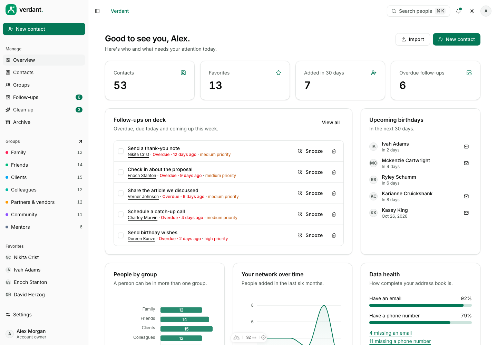
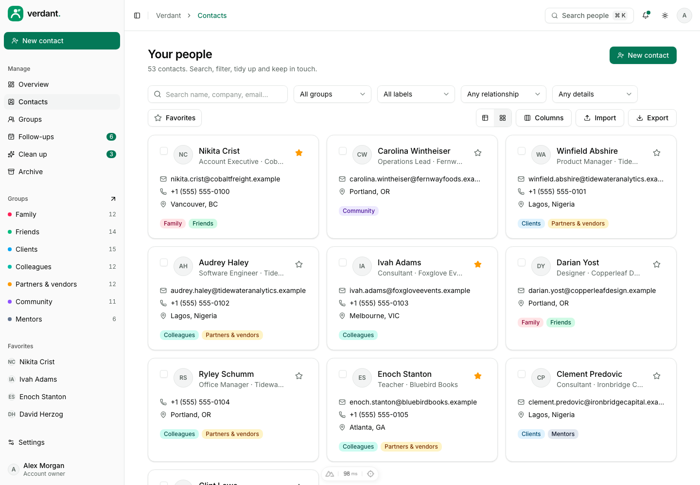
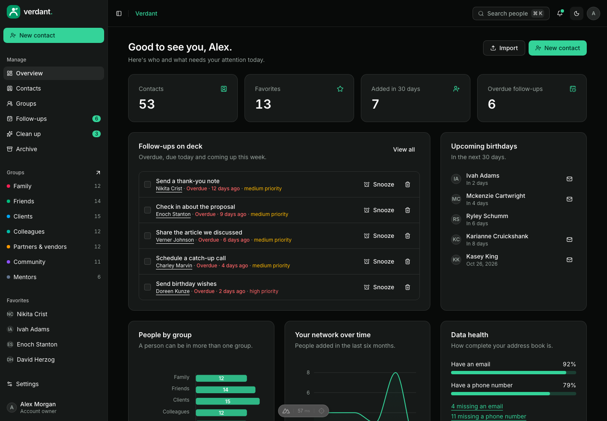
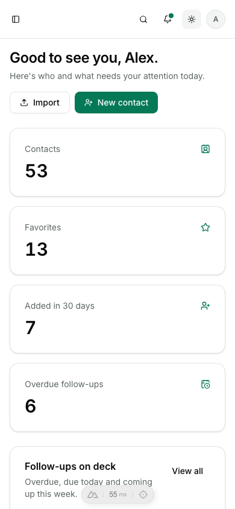

# Verdant · Contact manager

[](https://github.com/BayBreezy/ui-thing-layouts/actions/workflows/contacts-ui.yml)
[](../LICENSE.md)
[](https://verdant.behonbaker.com)
[](https://nuxt.com)
[](https://tailwindcss.com)
[](https://uithing.com)
[](https://bun.sh)
[](https://www.typescriptlang.org)
[](https://playwright.dev)
[](https://vitest.dev)

An interactive contact manager designed and built by [**Behon Baker**](https://behonbaker.com). Verdant takes the original Green Contact UI dashboard and turns it into a working address book: searchable and filterable contacts, groups, a follow-up planner, duplicate merging, CSV and vCard import/export, validated APIs, local persistence and accessible interactions.

[](https://verdant.behonbaker.com)

The existing live site is managed separately; this source update does not publish it. Other applications in the repository remain independent.

## Try it locally

Use **Bun 1.4.2** and **Node 22.12+**. CI and Netlify pin **Node 22.23.3** in `.nvmrc`. No credentials or database are required.

```bash
cd contacts-ui
bun install --frozen-lockfile
bun run dev
```

Open http://localhost:3000. Optionally copy `.env.example` to `.env` and set `NUXT_PUBLIC_SITE_URL` for canonical and social URLs.

```bash
bun run format
bun run format:check
bun run lint
bun run typecheck
bun run test
bunx playwright install chromium
bun run test:e2e
bun run build
bun run preview
bun run ui:add button
bun run clean
```

Run checks, API tests, browser tests and builds sequentially. Stop manually running dev servers before the API tests: Nuxt uses shared artifacts and a workspace server lock. Playwright starts a server on port 3200, or reuses one there outside CI.

Oxfmt handles formatting, import sorting and Tailwind ordering. Oxlint checks Vue scripts; type checking and browser tests cover templates.

## A five-minute walkthrough

1. **Overview:** see who needs attention: overdue follow-ups, upcoming birthdays, people you haven't spoken to in a while, and how complete your address book is.
2. **Contacts:** search, filter by group, label, relationship or missing details, sort, and page. Everything lives in the URL, so a view can be bookmarked or shared. Switch between the table and cards, choose columns, select rows and act on them together.
3. **A contact:** open someone to see their details, log calls and emails on a timeline, schedule follow-ups, edit anything, favorite, archive or download a vCard.
4. **Groups:** create groups with a color and icon, add or remove members, and export a group.
5. **Follow-ups:** work through overdue, due-today and upcoming reminders; complete, snooze or add new ones.
6. **Clean up:** merge likely duplicates (same email, phone or name) and fill in missing details.
7. **Import and export:** paste or upload a CSV, review row-level problems and duplicates, then import. Export everything, a selection or a group as CSV, or vCards.
8. **Archive and settings:** restore or permanently delete archived contacts, rename labels across everyone, tune preferences, download a backup, or reset the demo.

Try **Command/Ctrl + K**, mobile navigation and both themes. The whole app is available without signing in.

## Architecture and boundaries

| Layer                                          | Responsibility                                                               |
| ---------------------------------------------- | ---------------------------------------------------------------------------- |
| app/pages, app/layouts, app/components/Verdant | Real routes, shell, editors and feature views                                |
| app/components/Ui                              | Copied UI Thing primitives using Reka UI and Tailwind 4, plus TanStack Table |
| shared                                         | Typed records, Yup validation, search, duplicates, CSV and vCard             |
| server/utils/fixtures.ts                       | Server-only Faker, seed 42, fixed dates, handwritten groups                  |
| server/api/demo                                | Stateless validators, a CSV parser and a merge endpoint                      |
| app/composables/useDemo.ts                     | Reactive visitor records and centralized mutations                           |
| app/composables/useContactsTable.ts            | Keeps the contacts list's search, filters, sort and page in the URL          |
| app/plugins/persistence.client.ts              | Validated, versioned localStorage restoration and persistence                |

The seed includes 57 contacts (four archived, three planted duplicates), seven groups, 143 logged interactions and 25 follow-ups. Dates are generated relative to a fixed demo day, October 12, 2026, so the data always looks current and tests are deterministic.

SSR loads the seed through `useAsyncData`. After hydration, the browser restores `verdant-demo-v1`; browser-created routes wait before showing missing records. Successful API responses update records, activity and notifications together. Failures preserve input. APIs never retain visitor edits or use shared function memory as a database.

Reset aborts pending requests and advances a revision, so late responses cannot overwrite the fresh data. A storage failure leaves a usable in-memory session with visible feedback, and a corrupt snapshot is replaced by a fresh demo with an explanation.

All data is fictional. No messages are sent, no emails or phone numbers are contacted, and passwords are validated locally but never logged, stored or returned. Use fictional credentials. Signing out retains local work.

Contact notes and everything else a visitor types are rendered as text. CSV export neutralizes cells that spreadsheets would treat as formulas, and the importer undoes that on the way back in.

## Demo API reference

| Endpoint                         | Result                                                     |
| -------------------------------- | ---------------------------------------------------------- |
| GET /api/demo/bootstrap          | Reproducible complete workspace                            |
| POST /api/demo/contacts/save     | Validated contact                                          |
| POST /api/demo/contacts/bulk     | Validated bulk action (favorite, archive, group, label, …) |
| POST /api/demo/contacts/import   | Parsed CSV: valid rows, row errors and duplicates          |
| POST /api/demo/contacts/merge    | Merged contact and the id of the one to remove             |
| POST /api/demo/groups/save       | Validated group                                            |
| POST /api/demo/interactions/save | Validated logged interaction                               |
| POST /api/demo/follow-ups/save   | Validated follow-up                                        |
| POST /api/demo/settings/save     | Validated profile and preferences                          |
| POST /api/demo/records/delete    | Acknowledged deletion of a group, interaction or follow-up |
| POST /api/demo/auth/:action      | Demo login, signup, recovery and reset                     |

Save requests contain a record and a reference context with `groupIds` and `contactIds`, so relationships can be checked without server state. Invalid fields, dates or references return HTTP 400; unknown account actions return 404.

```bash
curl http://localhost:3000/api/demo/bootstrap
curl -X POST http://localhost:3000/api/demo/contacts/import \
  -H 'Content-Type: application/json' \
  -d '{"csv":"first_name,last_name,email\nGrace,Hopper,grace@example.com","context":{"groups":[],"emails":[]}}'
```

## Styling, verification and screenshots

Theme tokens live in the Tailwind CSS foundation (`app/assets/css/tailwind.css`). `verdant.css` only adds the page container, avatar tints and reduced-motion support; everything else is composed from the UI Thing components in `app/components/Ui`. The primary color is emerald, adjusted for contrast: `#047857` in light mode and `#34d399` in dark mode, with green-tinted neutrals. The brand green `#009966` is used for the logo and the browser theme color. Inter is self-hosted from `public/fonts`, so builds need no font provider. Icons come from Lucide and the branding is plain SVG.

Re-running `ui-thing add` regenerates the Tailwind foundation and can overwrite local adjustments. After a refresh, re-apply the emerald tokens in `tailwind.css`, and keep two small edits to the generated components:

- `app/components/Ui/Sidebar/Provider.vue` only trusts the viewport media query after mount, so phones do not fail hydration.
- The generated Vee form components use `AnimatePresence`, which is registered by the `motion-v/nuxt` module in `nuxt.config.ts`.

Vitest covers reproducibility, relationships, validation, search, birthdays, duplicates and merging, CSV and vCard, connected mutations, cascading deletes, failed saves, reset races and real Nitro responses. Playwright exercises the contact lifecycle, URL-persisted filters, bulk actions, import, merging, follow-ups, the command palette, unsaved navigation, request and storage failures, every route for hydration and social tags, and axe scans in light, dark and phone layouts.

The scoped workflow at [../.github/workflows/contacts-ui.yml](../.github/workflows/contacts-ui.yml) checks formatting, lint, types, tests, Chromium flows, production output, server-only Faker and the Netlify build.

With the development server running:

```bash
node scripts/screenshots.mjs
VERDANT_SCREENSHOT_URL=http://127.0.0.1:3200 node scripts/screenshots.mjs
node scripts/brand.mjs   # favicon.ico and apple-touch-icon.png from public/verdant.svg
```

## Netlify preparation

Use the existing Green Contact UI site's **base/package directory: contacts-ui**, app-local **netlify.toml**, **publish: dist**, Bun **1.4.2**, Node **22.23.3** and **NITRO_PRESET=netlify**. The TOML supplies frozen installation followed by the build. Commit `bun.lock` and use SSR/functions so the APIs and direct routes work together. Publishing is a separate action.

```bash
NITRO_PRESET=netlify bun run build
```

## Attribution

Designed and built by [Behon Baker](https://behonbaker.com). The original layout was modeled after the contacts table by the [Origin UI](https://ui-experiments-green.vercel.app/) team. Components: [UI Thing](https://uithing.com), [Reka UI](https://reka-ui.com), [TanStack Table](https://tanstack.com/table). Icons: [Lucide](https://lucide.dev). Typography: Inter. Fictional data: [Faker](https://fakerjs.dev). Tooling and architecture follow [Launchpad](../campaign-ui/) and [Orbit](../ai-chat/).





