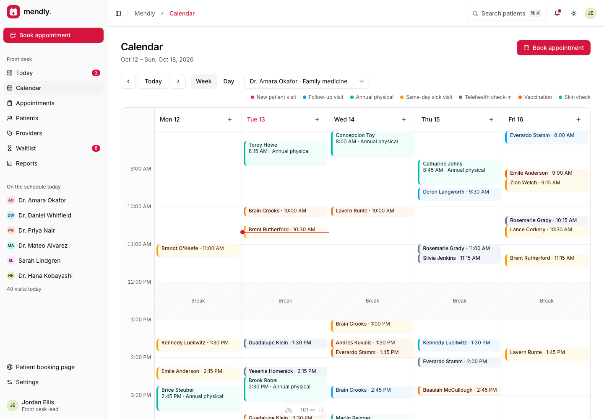
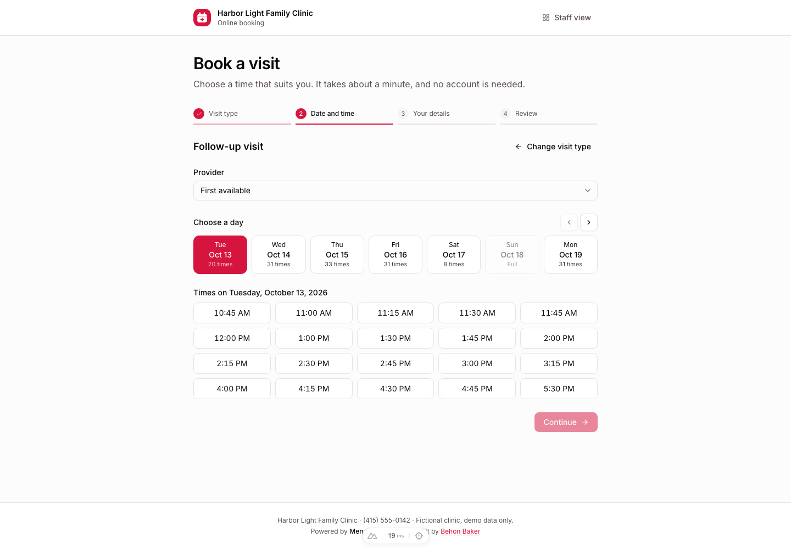
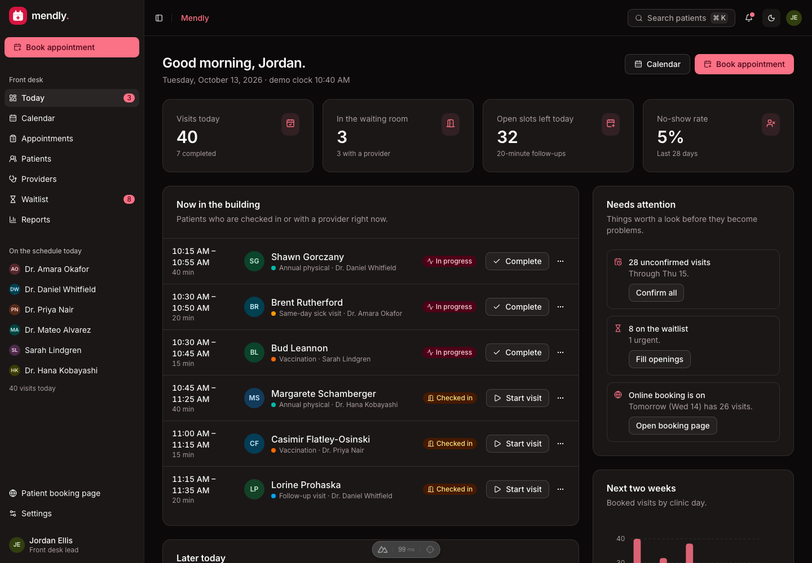
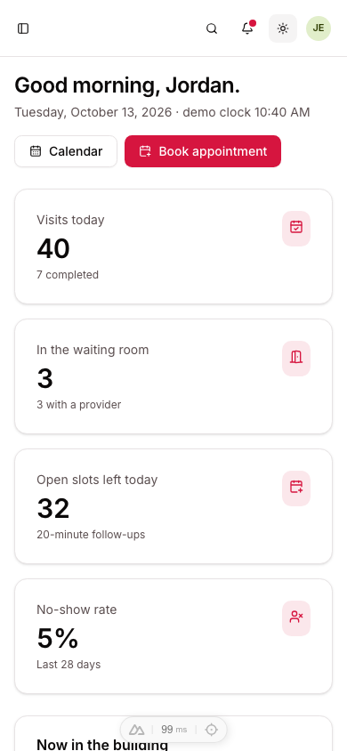

# Mendly · Appointment workspace

[](https://github.com/BayBreezy/ui-thing-layouts/actions/workflows/dr-appointment-ui.yml)
[](../LICENSE.md)
[](https://mendly.behonbaker.com)
[](https://nuxt.com)
[](https://tailwindcss.com)
[](https://uithing.com)
[](https://bun.sh)
[](https://www.typescriptlang.org)
[](https://playwright.dev)
[](https://vitest.dev)

An interactive appointment workspace for a small clinic, designed and built by [**Behon Baker**](https://behonbaker.com). Mendly takes the original Doctor Appointment dashboard and turns it into a working product: a front-desk schedule that cannot be double-booked, a week and day calendar, a patient directory, provider hours and days off, a waitlist that fills cancellations, reports, and a public booking page patients can use themselves.

[](https://mendly.behonbaker.com)

The existing live site is managed separately; this source update does not publish it. Other applications in the repository remain independent.

## Try it locally

Use **Bun 1.4.2** and **Node 22.12+**. CI and Netlify pin **Node 22.23.3** in `.nvmrc`. No credentials or database are required.

```bash
cd dr-appointment-ui
bun install --frozen-lockfile
bun run dev
```

Open http://localhost:3000. Optionally copy `.env.example` to `.env` and set `NUXT_PUBLIC_SITE_URL` for canonical and social URLs.

```bash
bun run format
bun run format:check
bun run lint
bun run typecheck
bun run test
bunx playwright install chromium
bun run test:e2e
bun run build
bun run preview
bun run ui:add button
bun run clean
```

Run checks, API tests, browser tests and builds sequentially. Stop manually running dev servers before the API tests: Nuxt uses shared artifacts and a workspace server lock. Playwright starts a server on port 3200, or reuses one there outside CI.

Oxfmt handles formatting, import sorting and Tailwind ordering. Oxlint checks Vue scripts; type checking and browser tests cover templates.

## A five-minute walkthrough

The demo clock is fixed at **Tuesday, October 13, 2026, 10:40 AM**, so the schedule always looks current and tests are deterministic.

1. **Today:** see who is in the waiting room, who is with a provider and what is still to come. Check patients in, start and complete visits with one click, confirm tomorrow's unconfirmed visits, and see the next two weeks' load.
2. **Calendar:** switch between a week for one provider and a day across everyone. Click a free spot, or use a column's **+** button, to book. Breaks, days off and hours outside a provider's schedule are shaded and cannot be booked.
3. **Appointments:** search, filter by when, status, provider and visit type, sort, page and act on several visits at once. Everything lives in the URL, so a view can be bookmarked or shared. Export what you see as CSV.
4. **A visit:** reschedule or edit (with live availability), move it through its status workflow, mark it missed or cancelled, and see the patient's other visits.
5. **Patients and providers:** keep records, tags and insurance; edit a provider's weekly hours, breaks, days off and visit types, and watch bookable times change.
6. **Waitlist:** patients who want an earlier slot are matched against live openings, most urgent first. Cancel a visit and the waitlist is the first thing you see.
7. **Reports:** outcomes by day, visit mix, provider utilization, no-show and cancellation rates.
8. **Book online:** open **/book** as a patient. Choose a visit, a provider (or first available), a day and a time, enter details and confirm. The visit appears in the staff schedule with the source "online", and the confirmation offers an `.ics` calendar file.

Try **Command/Ctrl + K**, mobile navigation and both themes. The whole app is available without signing in.

## The rules that make it trustworthy

Scheduling rules live in [`shared/schedule.ts`](shared/schedule.ts) as pure functions. The browser uses them for instant feedback and the demo API uses the very same code to validate every request.

- Times are clinic-local `YYYY-MM-DD` and `HH:mm` strings, never UTC, so the server and every browser agree about what "9:30" means.
- A provider's bookable minutes are their working hours, minus breaks and days off, minus visits that still hold their slot, on the clinic's slot interval and sized by the visit type.
- Overlaps are refused for the same provider and for the same patient. Cancelled and missed visits free their slot.
- Status changes follow a workflow: `scheduled → confirmed → checked in → in progress → completed`, with `cancelled` and `no-show` as exits. Reinstating one needs its slot to still be free.
- Cancelling a visit looks for waitlisted patients who could take the opening.

## Architecture and boundaries

| Layer                                         | Responsibility                                                             |
| --------------------------------------------- | -------------------------------------------------------------------------- |
| app/pages, app/layouts, app/components/Mendly | Real routes, shells, editors and feature views                             |
| app/components/Ui                             | Copied UI Thing primitives using Reka UI and Tailwind 4                    |
| shared                                        | Typed records, Yup validation, scheduling rules, search, formatting, CSV   |
| server/utils/fixtures.ts                      | Server-only Faker, seed 42, fixed dates, hand-written providers and visits |
| server/api/demo                               | Stateless validators that re-check scheduling rules for every write        |
| app/composables/useDemo.ts                    | Reactive visitor records and centralized mutations                         |
| app/composables/useAppointmentsTable.ts       | Keeps the appointments list's search, filters, sort and page in the URL    |
| app/plugins/persistence.client.ts             | Validated, versioned localStorage restoration and persistence              |

The seed includes 6 providers, 7 visit types, 66 patients, about 740 visits across five weeks (with a realistic day today) and 8 waitlist entries. Dates are generated relative to the fixed demo day, so the data always looks current.

SSR loads the seed once and hands it to the browser. After hydration, the browser restores `mendly-demo-v1`; browser-created routes wait before showing missing records. Successful API responses update records, activity and notifications together. Failures preserve input. APIs never retain visitor edits or use function memory as a database.

Reset aborts pending requests and advances a revision, so late responses cannot overwrite the fresh data. A storage failure leaves a usable in-memory session with visible feedback, and a corrupt snapshot is replaced by a fresh demo with an explanation.

All data is fictional. No messages are sent and no one is contacted. Reminders and the patient booking page are simulated, and demo passwords are validated locally but never logged, stored or returned. Use fictional credentials. Signing out retains local work.

Everything a visitor types is rendered as text. CSV export neutralizes cells that spreadsheets would treat as formulas.

## Demo API reference

| Endpoint                           | Result                                                         |
| ---------------------------------- | -------------------------------------------------------------- |
| GET /api/demo/bootstrap            | Reproducible complete clinic                                   |
| POST /api/demo/appointments/save   | Validated booking, or the rules it breaks                      |
| POST /api/demo/appointments/status | A legal status change, re-checking the slot when reinstating   |
| POST /api/demo/appointments/bulk   | Which visits a bulk confirm or cancel applies to               |
| POST /api/demo/availability        | Open slots per day for a visit type and provider               |
| POST /api/demo/booking/submit      | A public online booking, re-checked so a taken slot is refused |
| POST /api/demo/waitlist/save       | Validated waitlist entry                                       |
| POST /api/demo/waitlist/offer      | A waitlisted patient booked into a chosen slot                 |
| POST /api/demo/patients/save       | Validated patient, refusing a duplicate email                  |
| POST /api/demo/providers/save      | Validated schedule, hours and visit types                      |
| POST /api/demo/settings/save       | Validated clinic, profile and preferences                      |
| POST /api/demo/records/delete      | Acknowledged deletion of a visit, patient or waitlist entry    |
| POST /api/demo/auth/:action        | Demo login, signup, recovery and reset                         |

Write requests carry a scheduling context (providers, visit lengths, and the visits on the relevant days) so rules can be checked without server state. Invalid fields, times or references return HTTP 400 with `data.errors`; unknown account actions return 404.

```bash
curl http://localhost:3000/api/demo/bootstrap
curl -X POST http://localhost:3000/api/demo/records/delete \
  -H 'Content-Type: application/json' \
  -d '{"kind":"waitlist","id":"waitlist-1"}'
```

## Styling, verification and screenshots

Theme tokens live in the Tailwind CSS foundation (`app/assets/css/tailwind.css`). `mendly.css` only adds the page container, avatar tints and reduced-motion support; everything else is composed from the UI Thing components in `app/components/Ui`. The primary color is coral rose, tuned for contrast: `#d6153f` in light mode (5.2:1 on white) and `#fb7185` in dark mode, with warm-tinted neutrals. Destructive actions use a deeper red and always sit behind a confirmation, and every status is shown with an icon and a word, never by color alone. Inter is self-hosted from `public/fonts`, so builds need no font provider. Icons come from Lucide and the branding is plain SVG.

Re-running `ui-thing add` regenerates the Tailwind foundation and can overwrite local adjustments. After a refresh, re-apply the coral tokens in `tailwind.css`, and keep these small edits to the generated components:

- `app/components/Ui/Sidebar/Provider.vue` only trusts the viewport media query after mount, so phones do not fail hydration.
- `app/components/Ui/Tabs/List.vue` uses `text-muted-foreground` rather than a 70% opacity, which fails contrast for inactive tabs.
- `app/components/Ui/Apexchart.client.vue` uses coral chart defaults instead of blue.
- The generated Vee form components use `AnimatePresence`, which is registered by the `motion-v/nuxt` module in `nuxt.config.ts`.

Vitest covers reproducibility, relationships, validation, the scheduling rules and their edge cases (back-to-back visits, breaks, days off, slot rounding), CSV, connected mutations, cascading deletes, failed saves, reset races and real Nitro responses. Playwright exercises booking and double-booking prevention, the front-desk workflow, URL-persisted filters, bulk actions, the waitlist, the patient booking flow, the command palette, unsaved navigation, storage failures, every route for hydration and social tags, and axe scans in light, dark and phone layouts.

The scoped workflow at [../.github/workflows/dr-appointment-ui.yml](../.github/workflows/dr-appointment-ui.yml) checks formatting, lint, types, tests, Chromium flows, production output, server-only Faker and the Netlify build.

With the development server running:

```bash
node scripts/screenshots.mjs
MENDLY_SCREENSHOT_URL=http://127.0.0.1:3200 node scripts/screenshots.mjs
node scripts/brand.mjs   # favicon.ico and apple-touch-icon.png from public/mendly.svg
```

## Netlify preparation

Use the existing Netlify site (renamed `mendly-app`, serving `mendly.behonbaker.com`) with **base/package directory: dr-appointment-ui**, app-local **netlify.toml**, **publish: dist**, Bun **1.4.2**, Node **22.23.3** and **NITRO_PRESET=netlify**. The TOML supplies frozen installation followed by the build. Commit `bun.lock` and use SSR/functions so the APIs and direct routes work together. Publishing is a separate action.

```bash
NITRO_PRESET=netlify bun run build
```

## Attribution

Designed and built by [Behon Baker](https://behonbaker.com). The original layout was a Doctor Appointment dashboard built with [UI Thing](https://uithing.com). Components: [UI Thing](https://uithing.com), [Reka UI](https://reka-ui.com). Charts: [ApexCharts](https://apexcharts.com). Icons: [Lucide](https://lucide.dev). Typography: Inter. Fictional data: [Faker](https://fakerjs.dev). Tooling and architecture follow [Verdant](../contacts-ui/), [Launchpad](../campaign-ui/) and [Orbit](../ai-chat/).





