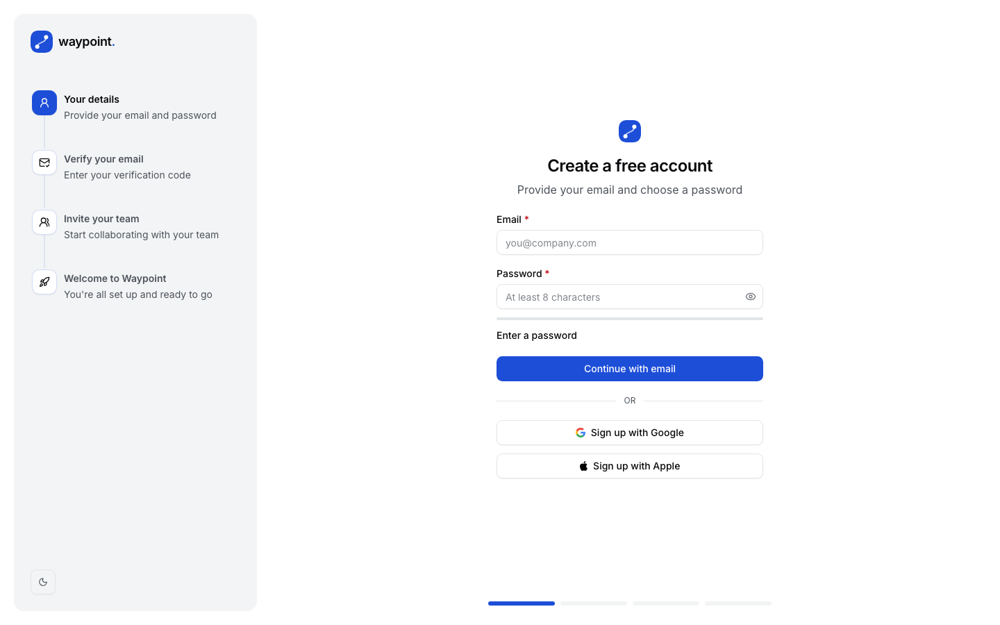
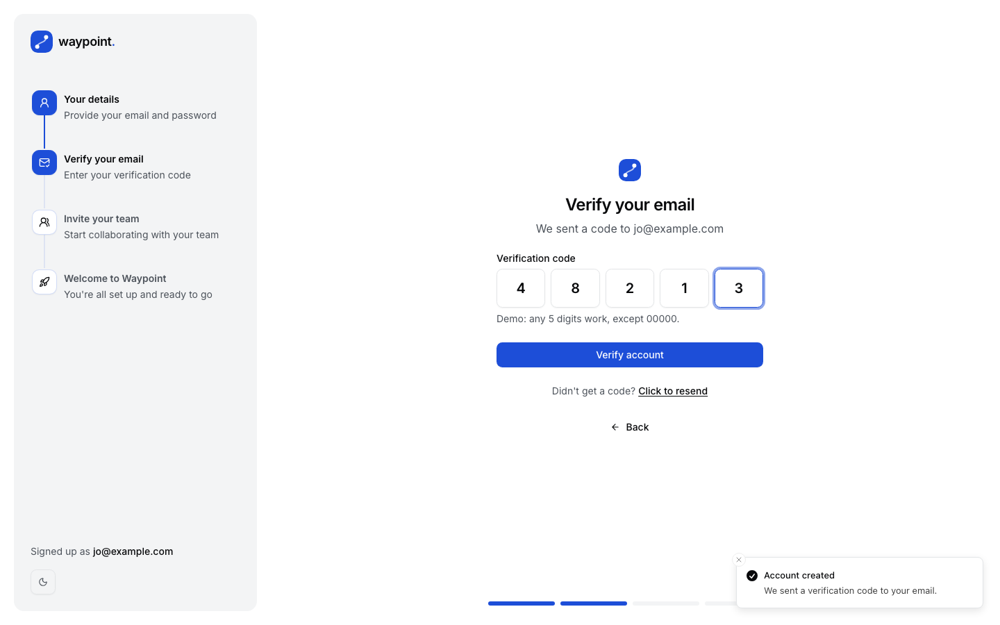
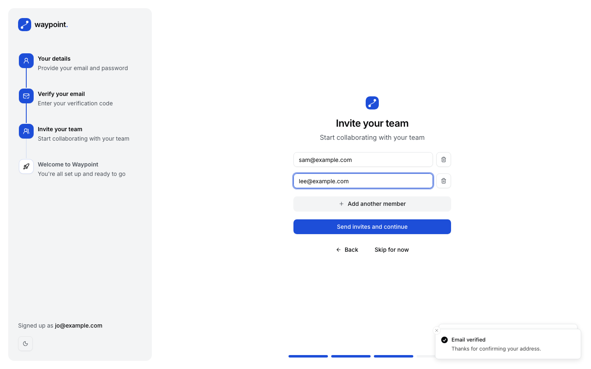
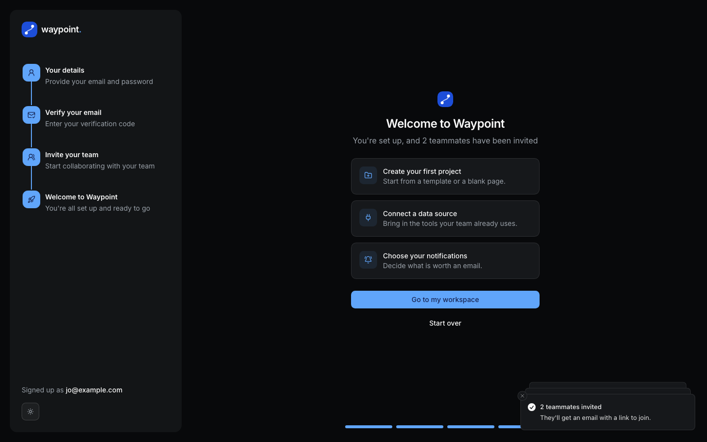
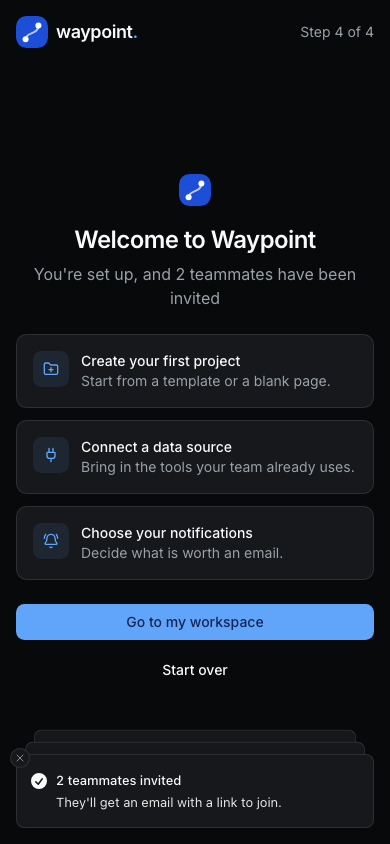

# Waypoint · Onboarding flow

[](https://github.com/BayBreezy/ui-thing-layouts/actions/workflows/onboarding-steps-ui.yml)
[](../LICENSE.md)
[](https://waypoint.behonbaker.com)
[](https://nuxt.com)
[](https://tailwindcss.com)
[](https://uithing.com)
[](https://bun.sh)
[](https://www.typescriptlang.org)
[](https://playwright.dev)
[](https://vitest.dev)

A four-step onboarding flow, designed and built by [**Behon Baker**](https://behonbaker.com): create an account, verify your email, invite your team, and land on a welcome screen. It started as a single static layout and is now a small working flow with real validation, server-side errors, a progress timeline, light and dark themes and a phone layout.

[](https://waypoint.behonbaker.com)

The live site is managed separately; this source update does not publish it. Other applications in the repository remain independent.

## Try it locally

Use **Bun 1.4.2** and **Node 22.12+**. CI and Netlify pin **Node 22.23.3** in `.nvmrc`. No credentials or database are required.

```bash
cd onboarding-steps-ui
bun install --frozen-lockfile
bun run dev
```

Open http://localhost:3000. Optionally copy `.env.example` to `.env` and set `NUXT_PUBLIC_SITE_URL` for canonical and social URLs.

```bash
bun run format
bun run format:check
bun run lint
bun run typecheck
bun run test
bunx playwright install chromium
bun run test:e2e
bun run build
bun run preview
bun run ui:add button
bun run clean
```

Run checks, API tests, browser tests and builds sequentially. Stop manually running dev servers before the API tests: Nuxt uses shared artifacts and a workspace server lock. Playwright starts a server on port 3200, or reuses one there outside CI.

Oxfmt handles formatting, import sorting and Tailwind ordering. Oxlint checks Vue scripts; type checking and browser tests cover templates.

## A one-minute walkthrough

1. **Your details:** enter an email and a password. The password field shows a live strength meter and the requirements it checks. Submit with nothing to see the field errors. `taken@example.com` is always "already registered", so the server-side error shows inline.
2. **Verify your email:** type any five digits, or paste them in. `00000` is always rejected so the failed state can be seen. Resend has a 30 second cooldown. **Back** returns to step one with your email kept.
3. **Invite your team:** add up to four people. Blank rows are ignored, repeats are removed, and your own address is left out. **Skip for now** is a first-class way through.
4. **Welcome:** a summary of what happened and three suggested next steps. **Start over** resets the demo.

The current step lives in the URL (`?step=3`), so the browser's back button works. It can never run ahead of what was completed: editing the URL to `?step=4` lands on step one.

Nothing is stored and no email is sent. Reloading starts over.

## Architecture

| Path                             | Responsibility                                                             |
| -------------------------------- | -------------------------------------------------------------------------- |
| app/pages/index.vue              | Picks the step component from the URL and moves focus to its heading       |
| app/layouts/default.vue          | Sidebar rail, mobile header and progress bars                              |
| app/components/Waypoint          | The four steps, sidebar, progress bars, logo and heading                   |
| app/components/Ui                | Copied UI Thing primitives using Reka UI and Tailwind 4                    |
| app/composables/useOnboarding.ts | Step state: current step, furthest reached step, email and invitees        |
| shared/onboarding.ts             | The step list, Yup schemas and the small pure rules used by client and API |
| server/api/onboarding/[action]   | Simulated register, verify and invite endpoints with the same validation   |

The Yup schemas in [`shared/onboarding.ts`](shared/onboarding.ts) are used by the forms and by the API, so both reject the same input with the same messages.

## Demo API reference

| Endpoint                      | Result                                                            |
| ----------------------------- | ----------------------------------------------------------------- |
| POST /api/onboarding/register | `{ simulated, email }`, or 409 for the taken address              |
| POST /api/onboarding/verify   | `{ simulated, verified }`, or 422 for the rejected code           |
| POST /api/onboarding/invite   | `{ simulated, invited }`, cleaned of blanks, repeats and yourself |

Invalid input returns HTTP 400 with `data.errors`; unknown actions return 404.

```bash
curl -X POST http://localhost:3000/api/onboarding/register \
  -H 'Content-Type: application/json' \
  -d '{"email":"jo@example.com","password":"correct-horse"}'
```

## Styling, verification and screenshots

Theme tokens live in the Tailwind CSS foundation (`app/assets/css/tailwind.css`). `waypoint.css` only adds the step transition and reduced-motion support; everything else is composed from the UI Thing components in `app/components/Ui`. The primary color is blue, tuned for contrast: `#1d4ed8` in light mode (6.7:1 on white) and `#60a5fa` in dark mode, with cool slate neutrals. Inter is self-hosted from `public/fonts`, so builds need no font provider. Icons come from Lucide and the branding is plain SVG.

Re-running `ui-thing add` regenerates the Tailwind foundation and can overwrite local adjustments. After a refresh, re-apply the blue tokens in `tailwind.css`. The generated Vee form components use `AnimatePresence`, which is registered by the `motion-v/nuxt` module in `nuxt.config.ts`.

Vitest covers the schemas, the invite cleanup, the step clamp, the progress bars and real Nitro responses. Playwright walks every step, checks the field and server errors, the URL guard, focus handling, the theme switch and the phone layout, and runs axe scans on all four steps.

The scoped workflow at [../.github/workflows/onboarding-steps-ui.yml](../.github/workflows/onboarding-steps-ui.yml) checks formatting, lint, types, tests, Chromium flows and the production and Netlify builds.

With the development server running:

```bash
node scripts/screenshots.mjs
WAYPOINT_SCREENSHOT_URL=http://127.0.0.1:3200 node scripts/screenshots.mjs
node scripts/brand.mjs   # favicon.ico and apple-touch-icon.png from public/waypoint.svg
```

## Netlify preparation

Use the existing Netlify site (renamed `waypoint-onboarding-flow`, serving `waypoint.behonbaker.com` with `onboarding-steps-ui.behonbaker.com` as an alias) with **base/package directory: onboarding-steps-ui**, app-local **netlify.toml**, **publish: dist**, Bun **1.4.2**, Node **22.23.3** and **NITRO_PRESET=netlify**. The TOML supplies frozen installation followed by the build. Commit `bun.lock` and use SSR/functions so the APIs and direct routes work together. Publishing is a separate action.

```bash
NITRO_PRESET=netlify bun run build
```

## Attribution

Designed and built by [Behon Baker](https://behonbaker.com). The original layout was modeled after an [onboarding steps design on Dribbble](https://dribbble.com/shots/23081995-Onboarding-steps-Untitled-UI), built with [UI Thing](https://uithing.com). Components: [UI Thing](https://uithing.com), [Reka UI](https://reka-ui.com). Icons: [Lucide](https://lucide.dev) and [Logos](https://icon-sets.iconify.design/logos/). Typography: Inter. Tooling and architecture follow [Beacon](../site-overview-ui/), [Mendly](../dr-appointment-ui/), [Verdant](../contacts-ui/), [Launchpad](../campaign-ui/) and [Orbit](../ai-chat/).





