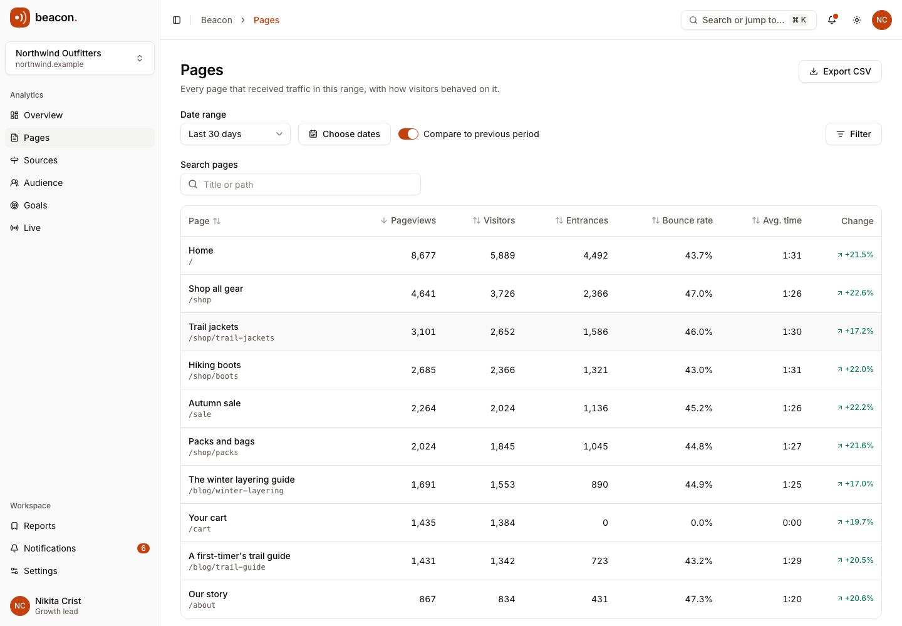
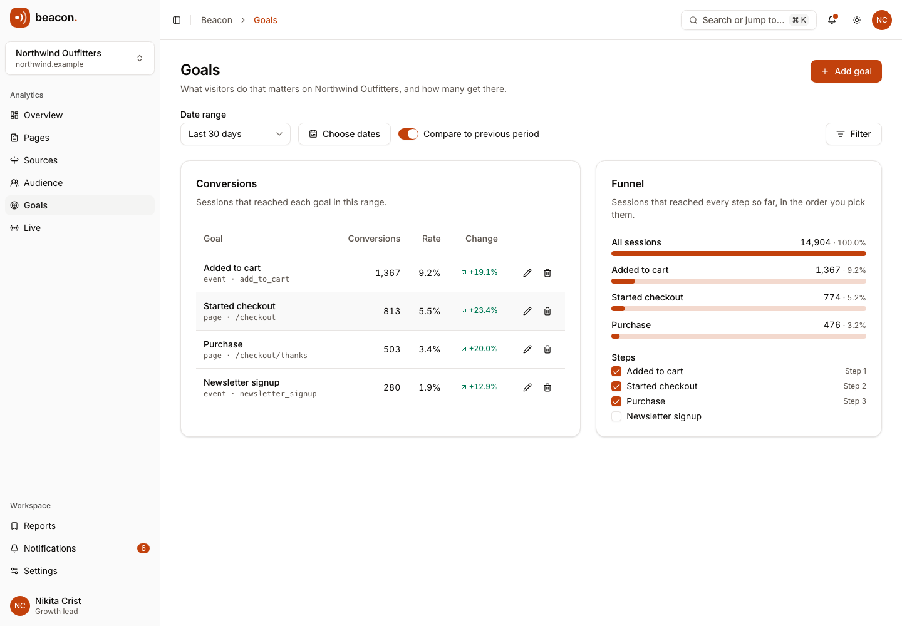
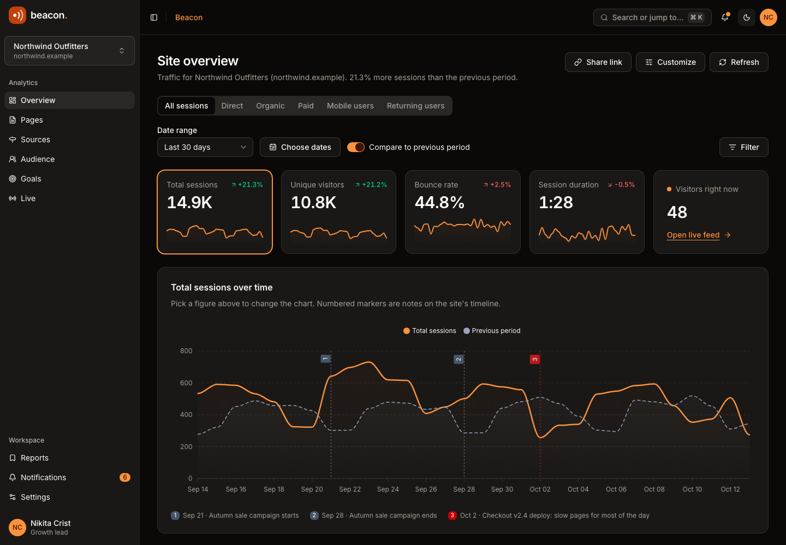
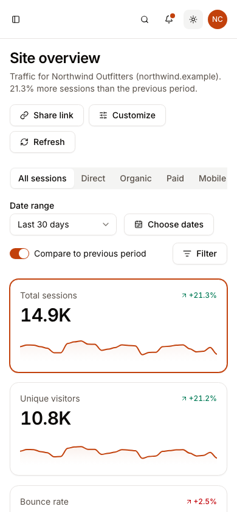

# Beacon · Site analytics workspace

[](https://github.com/BayBreezy/ui-thing-layouts/actions/workflows/site-overview-ui.yml)
[](../LICENSE.md)
[](https://beacon.behonbaker.com)
[](https://nuxt.com)
[](https://tailwindcss.com)
[](https://uithing.com)
[](https://bun.sh)
[](https://www.typescriptlang.org)
[](https://playwright.dev)
[](https://vitest.dev)

An interactive web analytics workspace, designed and built by [**Behon Baker**](https://behonbaker.com). Beacon takes the original Site Overview dashboard and turns it into a working product: a traffic overview whose segments, date ranges and filters really change every number, a pages table, sources and audience breakdowns, goals with a funnel, a simulated live feed, saved reports and notifications, across three fictional sites.

[](https://beacon.behonbaker.com)

The live site is managed separately; this source update does not publish it. Other applications in the repository remain independent.

## Try it locally

Use **Bun 1.4.2** and **Node 22.12+**. CI and Netlify pin **Node 22.23.3** in `.nvmrc`. No credentials or database are required.

```bash
cd site-overview-ui
bun install --frozen-lockfile
bun run dev
```

Open http://localhost:3000. Optionally copy `.env.example` to `.env` and set `NUXT_PUBLIC_SITE_URL` for canonical and social URLs.

```bash
bun run format
bun run format:check
bun run lint
bun run typecheck
bun run test
bunx playwright install chromium
bun run test:e2e
bun run build
bun run preview
bun run ui:add button
bun run clean
```

Run checks, API tests, browser tests and builds sequentially. Stop manually running dev servers before the API tests: Nuxt uses shared artifacts and a workspace server lock. Playwright starts a server on port 3200, or reuses one there outside CI.

Oxfmt handles formatting, import sorting and Tailwind ordering. Oxlint checks Vue scripts; type checking and browser tests cover templates.

## A five-minute walkthrough

The demo clock is fixed at **Tuesday, October 13, 2026, 2:20 PM**, so "today" always has a partial day of traffic and tests are deterministic. The data covers the 180 days before it.

1. **Overview:** four headline figures with real sparklines and change against the previous period, a chart of any of them with the previous period overlaid, and numbered notes on the timeline (a campaign, a deploy, an incident). Click a figure to chart it.
2. **Segments and filters:** switch between All, Direct, Organic, Paid, Mobile and Returning, change the date range (or pick custom dates), and add filters for channel, device, country and page. Select a source, country or device in a list to filter everything else. Everything lives in the URL, so a view can be bookmarked or shared with **Share link**.
3. **Customize:** show, hide and reorder the overview's sections. The layout is saved in the browser.
4. **Pages:** search, sort and page a table of every page with views, visitors, entrances, bounce rate and time on page; open a page's details; export CSV.
5. **Sources and audience:** channels, referrers, campaigns, countries, devices, browsers and new versus returning visitors.
6. **Goals:** add page or event goals, see conversions and rates against the previous period, and pick the steps of a funnel.
7. **Live:** a simulated stream of pageviews you can pause. It is generated for the demo; nothing is collected.
8. **Reports and notifications:** save the current view, reopen it later, duplicate it, set a (demo) email digest, and read the traffic changes Beacon found by comparing weeks.
9. **Sites:** switch between Northwind Outfitters (a shop), Fernlight Docs (developer docs) and Harbor & Pine Café, or add your own in Settings. Each site has its own goals, reports and notes.

Try **Command/Ctrl + K**, the mobile navigation and both themes. The whole app is available without signing in.

## The rules that make it trustworthy

Reporting rules live in [`shared/analytics.ts`](shared/analytics.ts) as pure functions. The demo API and the tests run the very same code, so it can move to a real backend unchanged.

- A session is one visit. **Visitors** are distinct people in the range, **pageviews** are every page viewed, and a **bounce** is a session that viewed one page.
- Dates are site-local `YYYY-MM-DD` strings, never UTC, so the server and every browser agree about which day a session belongs to.
- Filters are applied to the sessions before anything is counted, so every figure, list and chart agrees. The channel list adds up to the headline total.
- The previous period is the same number of days immediately before the range. When it would reach back before the data begins, Beacon says so instead of inventing a comparison. A change from zero is shown as "—", not as infinity.
- Ranges over 31 days are bucketed by week (starting Monday); shorter ranges by day. Days with no traffic are drawn as zero.
- A funnel counts sessions that reached every step so far, so each step can only be equal to or smaller than the one before.

## Architecture and boundaries

| Layer                                         | Responsibility                                                                    |
| --------------------------------------------- | --------------------------------------------------------------------------------- |
| app/pages, app/layouts, app/components/Beacon | Real routes, shells and feature views                                             |
| app/components/Ui                             | Copied UI Thing primitives using Reka UI and Tailwind 4                           |
| shared                                        | Typed records, Yup validation, reporting rules, dates, formatting, CSV, live feed |
| server/utils/fixtures.ts                      | Server-only Faker, seed 42, fixed dates, three sites of seeded sessions           |
| server/api/demo                               | The report endpoint, plus stateless validators for every write                    |
| app/composables/useDemo.ts                    | Reactive workspace records and centralized mutations                              |
| app/composables/useReportQuery.ts             | The report question, its setters and URL synchronization                          |
| app/composables/useReport.ts                  | Loads the report once for the layout; pages read the shared result                |
| app/plugins/persistence.client.ts             | Validated localStorage restoration and persistence                                |

The seed generates about 72,000 sessions for Northwind, 29,000 for Fernlight and 9,000 for Harbor & Pine, with weekday seasonality, a growth trend, a paid campaign surge, a social launch spike and a checkout incident. The server keeps them in memory and counts them per request, so cross-filtering is real. A small seeded generator creates the volume; Faker supplies names and the long tail of referrers.

SSR loads the seed once and hands it to the browser. After hydration, the browser restores `beacon-demo-v1`; the overview then asks the API for a report using the saved preferences, and shows skeletons until it arrives. Successful API responses update records and the inbox together. Failures preserve input. APIs never retain visitor edits.

Reset aborts pending requests and advances a revision, so late responses cannot overwrite the fresh data. A storage failure leaves a usable in-memory session with visible feedback, and a corrupt snapshot is replaced by a fresh demo with an explanation.

All data is fictional. The tracking snippet in Settings is illustrative: this demo collects no real traffic, sends no email, and demo passwords are validated locally but never logged, stored or returned. Everything a visitor types is rendered as text, and CSV export neutralizes cells that spreadsheets would treat as formulas.

## Demo API reference

| Endpoint                        | Result                                                      |
| ------------------------------- | ----------------------------------------------------------- |
| GET /api/demo/bootstrap         | Reproducible workspace: sites, goals, notes, reports, inbox |
| POST /api/demo/report           | A full report for a range, segment, filters and goals       |
| POST /api/demo/goals/save       | Validated goal, checking its site exists                    |
| POST /api/demo/reports/save     | Validated saved report                                      |
| POST /api/demo/sites/save       | Validated site, refusing a malformed domain                 |
| POST /api/demo/annotations/save | Validated timeline note                                     |
| POST /api/demo/settings/save    | Validated profile and preferences                           |
| POST /api/demo/records/delete   | Acknowledged deletion of a goal, report, site or note       |
| POST /api/demo/auth/:action     | Demo login, signup, recovery and reset                      |

Reports clamp ranges to the window the data covers. Invalid fields, dates or references return HTTP 400 with `data.errors`; unknown account actions return 404.

```bash
curl http://localhost:3000/api/demo/bootstrap
curl -X POST http://localhost:3000/api/demo/report \
  -H 'Content-Type: application/json' \
  -d '{"query":{"siteId":"northwind","from":"2026-09-14","to":"2026-10-13","compare":true,"segment":"organic","filters":{"channel":"","device":"","country":"","page":""},"interval":"auto"},"site":{"id":"northwind","pages":[]},"goals":[],"funnel":[]}'
```

## Styling, verification and screenshots

Theme tokens live in the Tailwind CSS foundation (`app/assets/css/tailwind.css`). `beacon.css` only adds the page container and reduced-motion support; everything else is composed from the UI Thing components in `app/components/Ui`. The primary color is orange, tuned for contrast: `#c2410c` in light mode (5.2:1 on white) and `#fb923c` in dark mode, with warm stone neutrals. Chart series use orange, sky, slate, amber and cyan. Up and down changes use conventional status colors and always carry an arrow and a word for screen readers, never color alone. Inter is self-hosted from `public/fonts`, so builds need no font provider. Icons come from Lucide and the branding is plain SVG.

Re-running `ui-thing add` regenerates the Tailwind foundation and can overwrite local adjustments. After a refresh, re-apply the orange tokens in `tailwind.css`, and keep these small edits to the generated components:

- `app/components/Ui/Sidebar/Provider.vue` only trusts the viewport media query after mount, so phones do not fail hydration.
- `app/components/Ui/Tabs/List.vue` uses `text-muted-foreground` rather than a 70% opacity, which fails contrast for inactive tabs.
- `app/components/Ui/Apexchart.client.vue` uses orange chart defaults.
- The generated Vee form components use `AnimatePresence`, which is registered by the `motion-v/nuxt` module in `nuxt.config.ts`.

Vitest covers date edge cases, comparison and zero handling, bucketing, segments, cross-filtering, goals and funnels, CSV, seed reproducibility and reconciliation, snapshot validation, connected mutations, failed saves, reset races, report parameters and real Nitro responses. Playwright exercises segments, ranges, custom dates, filters and source selection, shared links, layout persistence, the pages table, goal validation, the live feed, saved reports, the command palette, site switching, storage failures, settings and reset, every route for hydration and social tags, the 404 page, and axe scans in light, dark and phone layouts.

The scoped workflow at [../.github/workflows/site-overview-ui.yml](../.github/workflows/site-overview-ui.yml) checks formatting, lint, types, tests, Chromium flows, production output, server-only Faker and the Netlify build.

With the development server running:

```bash
node scripts/screenshots.mjs
BEACON_SCREENSHOT_URL=http://127.0.0.1:3200 node scripts/screenshots.mjs
node scripts/brand.mjs   # favicon.ico and apple-touch-icon.png from public/beacon.svg
```

## Netlify preparation

Use the existing Netlify site (renamed `beacon-site-analytics`, serving `beacon.behonbaker.com` with `site-overview-ui.behonbaker.com` as an alias) with **base/package directory: site-overview-ui**, app-local **netlify.toml**, **publish: dist**, Bun **1.4.2**, Node **22.23.3** and **NITRO_PRESET=netlify**. The TOML supplies frozen installation followed by the build. Commit `bun.lock` and use SSR/functions so the APIs and direct routes work together. Publishing is a separate action.

```bash
NITRO_PRESET=netlify bun run build
```

## Attribution

Designed and built by [Behon Baker](https://behonbaker.com). The original layout was a Site Overview dashboard in the style of Untitled UI, built with [UI Thing](https://uithing.com). Components: [UI Thing](https://uithing.com), [Reka UI](https://reka-ui.com). Charts: [ApexCharts](https://apexcharts.com). Icons: [Lucide](https://lucide.dev). Typography: Inter. Fictional data: [Faker](https://fakerjs.dev). Tooling and architecture follow [Mendly](../dr-appointment-ui/), [Verdant](../contacts-ui/), [Launchpad](../campaign-ui/) and [Orbit](../ai-chat/).





